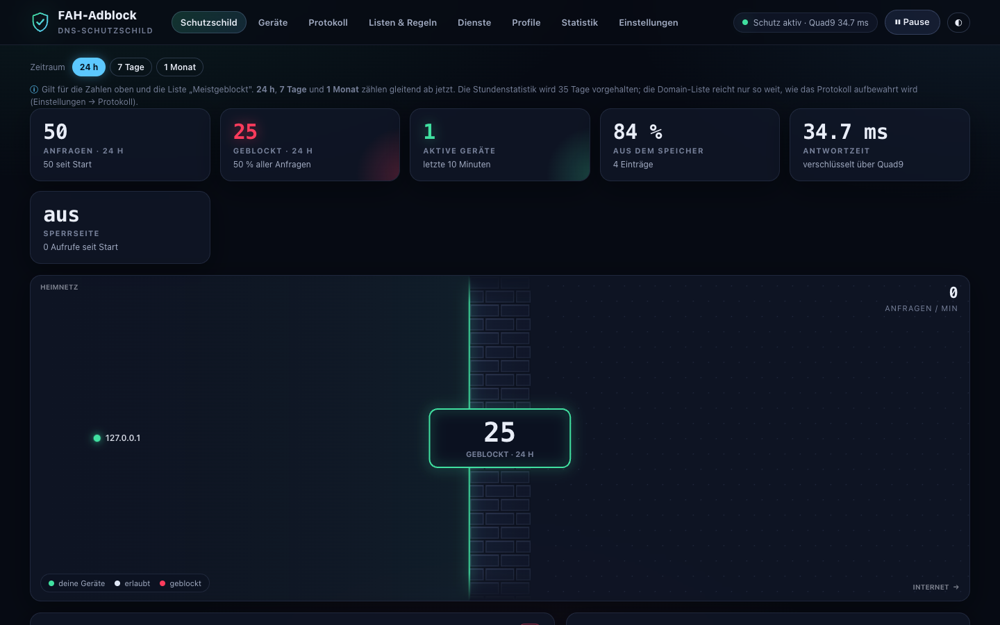
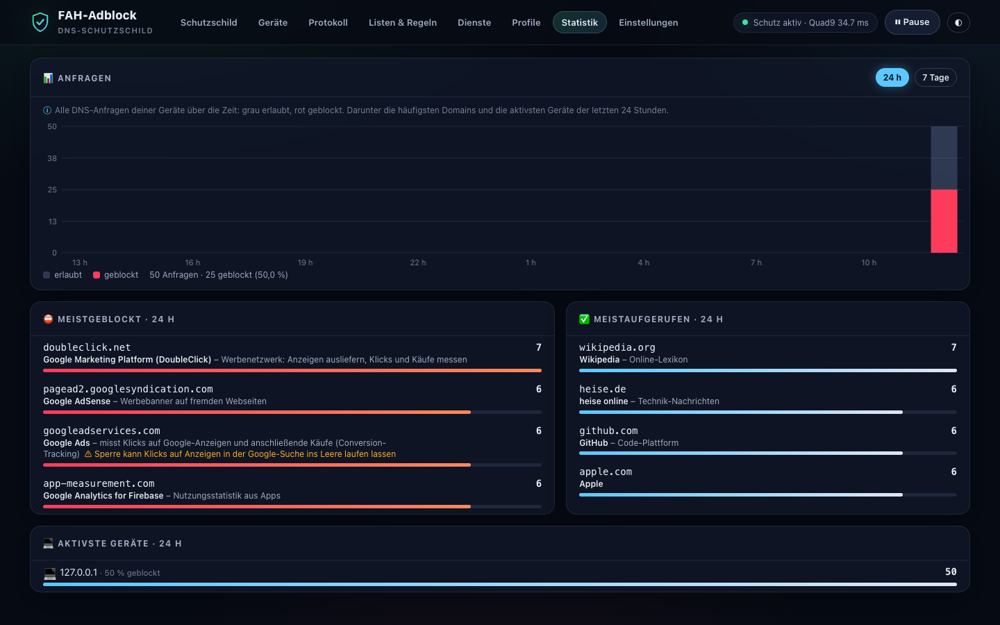
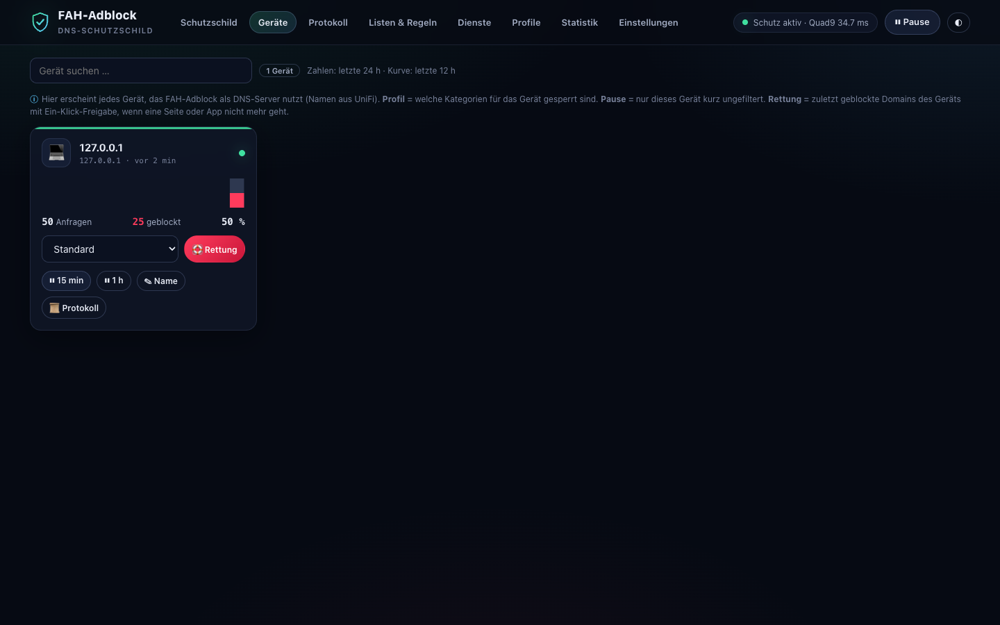
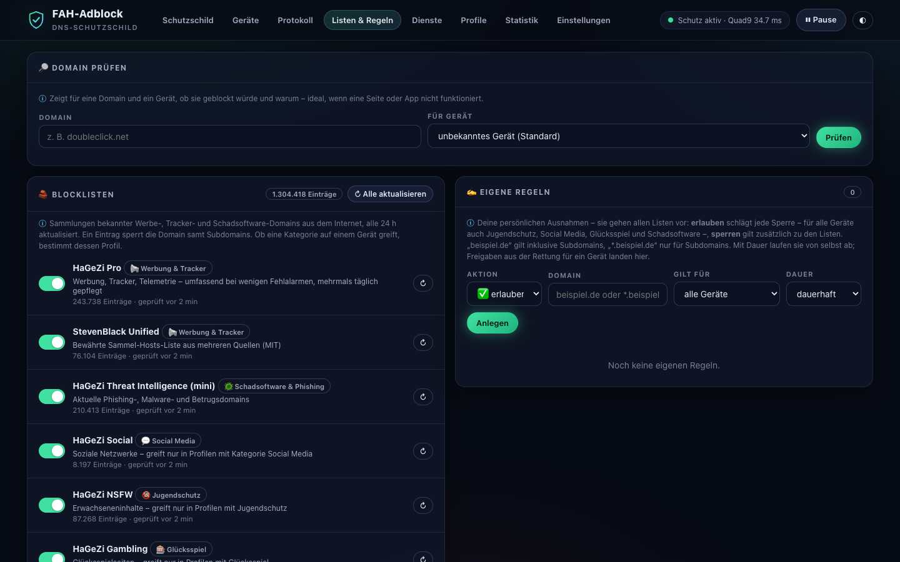
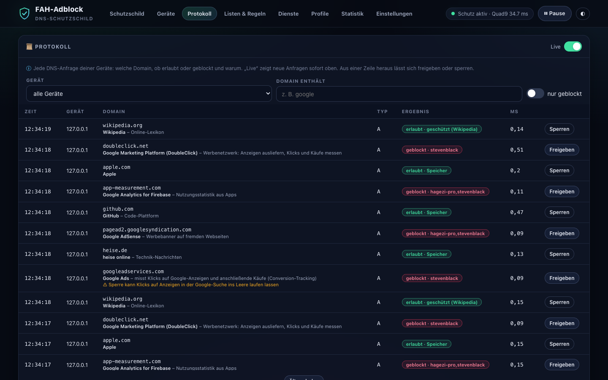
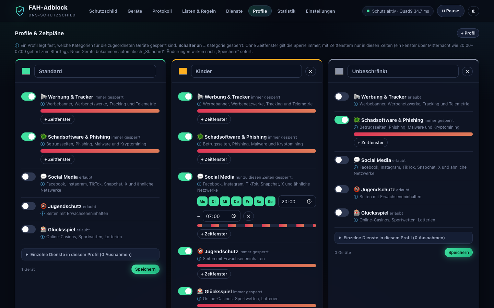
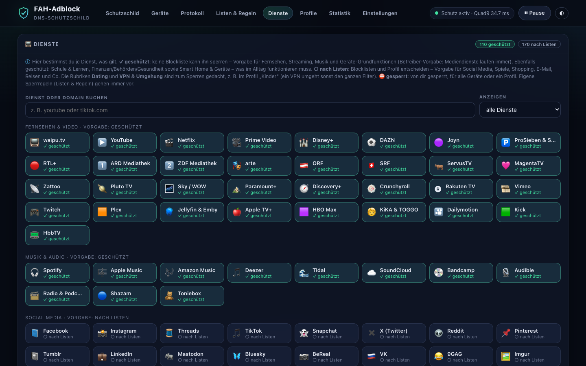
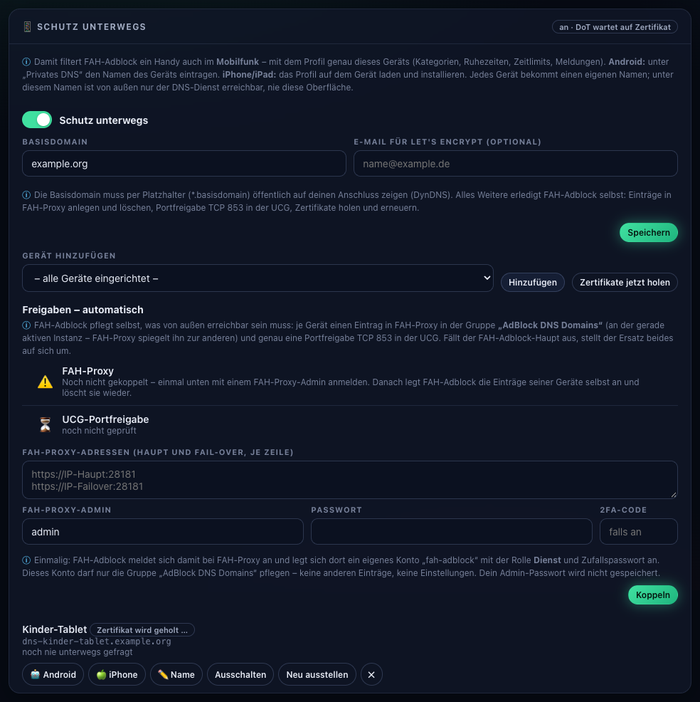
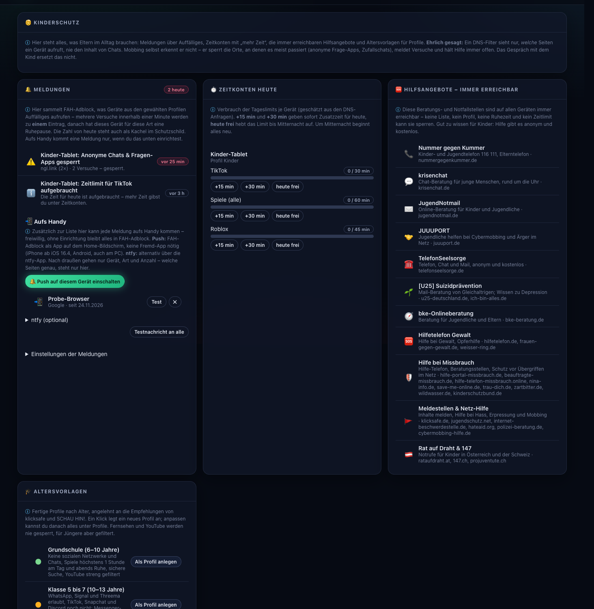
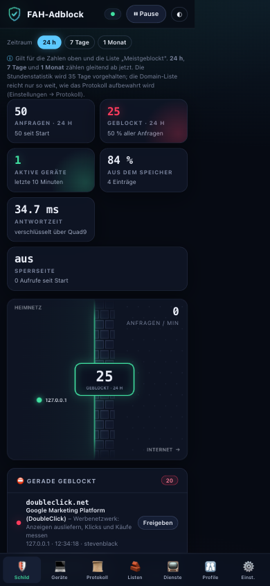

# FAH-Adblock

Netzweiter DNS-Werbe- und Trackerblocker für das Heimnetz – ein Docker-Container, Weboberfläche
im FAH-Stil. Entwurf: `docs/superpowers/specs/2026-09-15-fah-adblock-design.md`.

## Screenshots

*Aufgenommen mit Beispieldaten – nur Testabfragen von einem Rechner (127.0.0.1), keine echten Geräte oder Daten.*



| Statistik | Geräte |
|---|---|
|  |  |
| **Listen & Regeln** | **Protokoll** |
|  |  |
| **Profile & Zeitpläne** | **Dienste** |
|  |  |
| **Schutz unterwegs** | **Kinderschutz** |
|  |  |



## Funktionen
- **Blocklisten** (zur Laufzeit geladen, alle 24 h): HaGeZi Pro, StevenBlack, HaGeZi TIF (Schadsoftware),
  Social, NSFW, Gambling – je Kategorie; eigene Listen per URL.
- **Filter**: Pause (global/Gerät, 5/15/60 min) → Freigaben → eigene Sperren → Kategorien des Geräteprofils
  (mit Wochen-Zeitplänen, Fenster über Mitternacht), CNAME-Tarnung, Firefox-DoH-Kanarie.
- **Kinderschutz** (Ansicht „Kinderschutz“ – alles, was ein DNS-Filter für Kinder leisten kann):
  - Kategorien **Anonyme Chats & Fragen-Apps** (eigene Liste: NGL, Tellonym, Zufalls-Videochats …), **Drogen & Vaping**,
    **Umgehung** (VPN/Proxy/fremdes DNS/iCloud Privat-Relay), **Piraterie**; Betrugsliste optional.
  - **Hilfsangebote** (Nummer gegen Kummer, krisenchat, JUUUPORT …) fest geschützt – nie sperrbar.
  - Je Profil: **sichere Suche** (Google/Bing/DuckDuckGo), **YouTube eingeschränkt**, **Ruhezeiten je Rubrik**
    (z. B. Messenger nachts), **Tageslimits** je Dienst oder Rubrik mit Zeitkonto und „+15/+30 min“.
  - **Altersvorlagen** Grundschule, Klasse 5–7, ab 14.
  - **Meldungen in FAH-Adblock** (gebündelt, mit Ruhezeit, Kachel im Schutzschild) und **Umgehungsverdacht** (Gerät im WLAN, fragt aber nicht mehr);
    optional **aufs Handy**: Web-Push (FAH-Adblock als App auf dem Home-Bildschirm, RFC 8291/8292 ohne Fremdpakete) und/oder ntfy –
    nach draußen nur Gerät, Art und Anzahl; Ersatz bekommt alles verschlüsselt und springt bei Ausfall ein.
- **Schutz unterwegs** (eigene Ansicht „📱 Unterwegs“ – für jedes Gerät, nicht nur Kinder): filtert Handys und Tablets
  auch im Mobilfunk mit dem Profil des Geräts. Je Gerät ein kurzer Name (`dns-<gerät>.<basis>`) – Android „Privates DNS“
  (DNS-over-TLS, Port 853) und iPhone-Profil (DNS-over-HTTPS über FAH-Proxy) mit Kurzanleitung und Link zum Weitergeben;
  unter diesen Namen nur DNS, nie Oberfläche oder API. FAH-Adblock legt die Einträge in FAH-Proxy (Gruppe „AdBlock DNS
  Domains“, eingeschränktes Dienst-Konto) und die UCG-Portfreigabe selbst an und löscht sie wieder; Zertifikate kommen
  von FAH-Proxy, Fail-over inklusive.
- **Rettung**: zuletzt geblockte Domains eines Geräts, ein Klick gibt frei (Gerät 1 h / dauerhaft / alle).
- **Sperrseite**: gesperrte Seiten zeigen über FAH-Proxy den Hinweis „Diese Seite ist gesperrt“ mit Domain und Grund;
  Werbung und Tracker bleiben stumm geblockt. Das Zertifikat kommt einmal auf jedes Gerät.
- **Verschlüsseltes DNS nach außen** (DoH über HTTP/2: Quad9, Rückfall Cloudflare und DNS.SB – bewusst keine Anbieter mit eigener Werbesperre), Zwischenspeicher mit TTL,
  lokale Zonen (`example.org`, Rückwärtsauflösung) ans Gateway.
- **Geräte** über die UniFi-Clientliste (nur lesend) oder Rückwärtsauflösung; Namen/Profile je MAC.
- **Protokoll** in SQLite (`node:sqlite`, 7 Tage), Stunden-Summen, Livestrom (SSE), Statistik.
- **Sicherheit**: nur erlaubte Netze (kein offener Resolver), Bremse je Client (100/s, Schub 300),
  scrypt-Passwörter, signierte Sitzung, CSRF-Token, strenge CSP. Erststart `admin / admin`.

## Lizenzen
Nur MIT/Apache-2.0 – auch transitiv. Einzige Fremdbibliothek: `dns-packet` (MIT) mit
`@leichtgewicht/ip-codec` (MIT). Alles andere Node-24-Bordmittel. Prüfung: `node tools/lizenzprobe.mjs`.
Blocklisten werden nicht mitgeliefert (Lizenzen der Listen gelten für deren Nutzung).

## Betrieb (NAS)
```
/volume3/docker/fah-adblock/
  fah-adblock_release.zip  →  ./manage.sh update
```
- `.env` (einmalig aus `.env.example`): `DNS_BIND=192.168.1.23`, `WEB_PORT` (Portautomatik), `GATEWAY`, `ERLAUBTE_NETZE`.
- Container im Host-Netz (echte Client-IPs), nur `NET_BIND_SERVICE`, Daten in `./data`.
- Hinter einem Reverse-Proxy (NPM): `VERTRAUTE_PROXIES` bzw. Einstellungen → Netz → „Vertraute Proxys“ (z. B. `172.16.0.0/12`),
  sonst zählt die Anmeldebremse alle Internet-Anmeldungen als eine Adresse.
- `./manage.sh start|stop|restart|status|logs|url|port|test`.
- Geräte nutzen den Blocker erst, wenn ihr DNS auf `DNS_BIND` zeigt (Pilot: manuell am Gerät; später
  UniFi-DHCP: DNS 1 = NAS, DNS 2 = Gateway – nur nach Freigabe, mit Sicherung).

## Proben
| Probe | Zweck |
|---|---|
| `node tools/kernprobe.mjs` | Kern ohne Netz: Netze, Parser, Filter/Zeitpläne, Pakete, Upstream, Server-Ablauf, Protokoll, Anmeldung, Web-API |
| `node tools/dnsprobe.mjs --server=IP [--port=53] [--last=2000]` | echter DNS gegen den laufenden Dienst, optional Last |
| `node tools/oberflaechenprobe.mjs --basis=http://IP:PORT --dns=IP --dnsport=53` | Oberfläche in Chrome (CDP), Rettung wirkt im DNS |
| `node tools/lizenzprobe.mjs` | nur MIT/Apache-2.0 |

## Messwerte (15.09.2026, MacBook, Node 25)
918.724 Domains in 0,3 s geladen, Listentreffer ~1 µs, Heap ~105 MB. 1.841 Anfragen/s aus dem
Zwischenspeicher: 100 % beantwortet, p50 1,3 ms, p99 6 ms.
